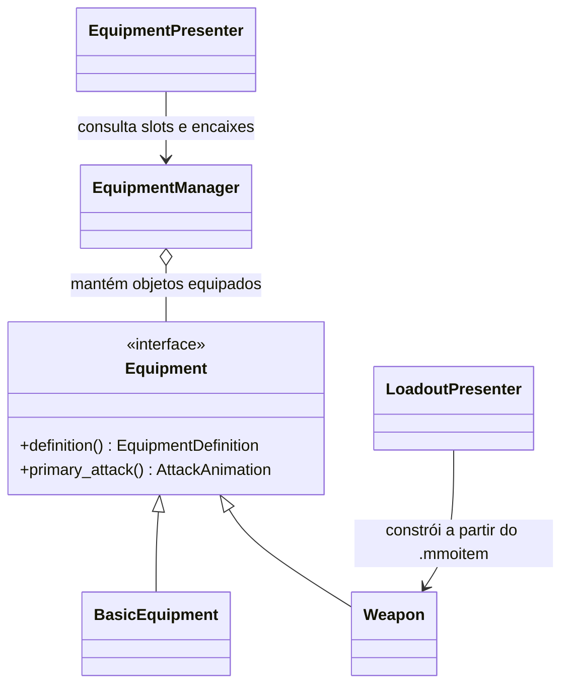

# Equipamentos: orientação a objetos

## Contrato e implementações

Em C++, uma interface costuma ser uma classe abstrata: métodos `virtual` com
`= 0` precisam ser implementados pelas classes concretas. `override` faz o
compilador conferir que o método realmente implementa o contrato. O destrutor
virtual permite destruir corretamente um objeto através do tipo base.



- `Equipment`: contrato do objeto equipável; não carrega arquivos nem desenha.
- `BasicEquipment`: implementação configurável para peças sem ataque, como armaduras e acessórios.
- `Weapon`: equipamento que fornece um ataque primário, com clip e tempos validados.
- `LoadoutPresenter` (`presentation/item_visuals`): constrói `Weapon` ou `BasicEquipment`
  a partir do arquivo `.mmoitem` do item; não há uma classe C++ por item (ver [itens](items.md)).
- `EquipmentDefinition`: dados do conteúdo (ID, nome, slot, modelo e encaixes).
- `EquipmentManager`: valida o encaixe no personagem e controla os slots.
- `EquipmentPresenter`: carrega modelos uma vez e envia as peças posicionadas ao renderer.

`definition()` é obrigatório; `primary_attack()` retorna `nullptr` por padrão.
Assim uma peça de armadura não precisa implementar um ataque vazio. `Weapon`
sobrescreve esse comportamento, e o controlador de combate consulta o contrato,
sem comparar IDs e sem `dynamic_cast` para tipos específicos.

## Exemplo de uso

```cpp
const presentation::ItemContent content = presentation::load_item_content("content/items");
const auto* sword = content.catalog.find("wooden_sword");
std::shared_ptr<const equipment::Equipment> item =
    presentation::make_equipment(*sword, content.visuals.at(sword->id));

std::string reason;
if (!player.model().equipment().equip(item, &reason)) {
    throw std::runtime_error(reason);
}
combat.request_primary_attack();
```

É a mesma ideia de guardar um `Weapon` em uma variável de tipo `Equipment`
em Java/C#. Em C++ usamos `shared_ptr` para manter o objeto vivo enquanto alguém
o utiliza. O gerenciador guarda o ponteiro para o objeto completo; copiar apenas
uma classe base por valor perderia seu comportamento específico (*object slicing*).
`unequip` devolve esse mesmo objeto, preservando o tipo concreto.

As implementações fornecidas mantêm a definição privada e imutável. O manager
recebe `shared_ptr<const Equipment>`; mudar os dados exige construir outro objeto
e passar novamente pela validação. Uma implementação nova deve respeitar esse
contrato e manter sua definição estável enquanto estiver equipada.

Não é necessário criar uma classe para cada cor ou material de espada. Quando
só os dados mudam, um `Weapon` com outra definição e outro `AttackAnimation` basta.
Uma subclasse só faz sentido quando existir comportamento visual que justifique
sobrescrever o contrato; itens novos são arquivos `.mmoitem`.

## Slots, validação e duração dos objetos

Slots: Helmet, Shoulders, Chest, Gloves, Pants, Boots, Cloak, Bracers, Ring1–Ring4,
Earring1–Earring2, MainHand e OffHand. Cada encaixe contém socket, bone e TRS local.
Um item pode usar vários bones, como ombreiras ou luvas.

O manager rejeita ponteiro nulo, slot inválido, ID/nome ausentes, extensão diferente
de `.glb`/`.gltf`, esqueleto inválido, bones inexistentes e transforms inválidos.
Uma tentativa malsucedida mantém o objeto anterior. `get_equipped` devolve um
ponteiro emprestado, válido enquanto o objeto continuar equipado ou houver outro
`shared_ptr` mantendo sua vida. Para guardar um item removido, use o retorno de
`unequip`.

## Separação entre regra, animação e desenho

```text
Loadout -> LoadoutPresenter -> EquipmentManager -> CombatController: ataque fornecido pelo objeto
                       |
                       +-> EquipmentPresenter + Pose -> Renderer
```

A aplicação cria os objetos e conecta os sistemas. O `CombatController` escolhe o
ataque pelo contrato e continua emitindo os eventos da animação. Sem uma arma que
forneça ataque primário, usa o golpe desarmado configurado. Vida, dano e validade
do alvo permanecem em `game/combat`; o dano, o intervalo e o alcance vêm dos
`weapon.*` do item, aplicados por `CombatSystem::set_weapon`.

O presenter resolve os assets e compõe `equipment::attachment_matrix` com a pose
atual. A matriz usa `Pose::global_matrices`, sem a inversa de bind do skinning:

```text
world_item = character_world * joint_global_pose * attachment_local
```

`Renderer::register_static_model` preserva o pivot do asset. Objetos do editor
compartilham a mesma mesh GPU e centralizam seu pivot apenas no desenho.
Remover um item elimina seu attachment no próximo frame.

## Build e testes

`mmo_animation` e `mmo_equipment` são bibliotecas separadas, sem OpenGL, GLFW, ImGui
ou fastgltf. `mmo_character` depende do contrato de equipamento, não de itens.
`mmo_presentation` liga itens (`mmo_game`) a equipamento; o `EquipmentPresenter`,
que usa o renderer, faz parte do cliente gráfico.

Os testes cobrem a espada real, slots, encaixes, falha sem substituir o item,
ponteiros nulos, duração dos objetos, remoção sem perda do tipo concreto e um
segundo `Weapon` com outro ID e clip. A integração verifica os ataques da espada,
da outra arma e o retorno ao golpe desarmado.

## Limites desta etapa

Attachments rígidos estão ligados ao jogador. Ainda não há inventário, drop,
persistência, catálogo JSON, equipamento de NPCs, roupas deformáveis ou IK dos
dedos. O encaixe da [espada](../content/items/wooden_sword/README.md) usa `hand_r`
do rig UAL; outro rig pode exigir ajustes. `EquipmentDefinition` descreve conteúdo
visual e animação, não uma instância persistente com durabilidade. As regras do item
(`ItemDefinition`, inventário, loadout) ficam em `game/items`.
