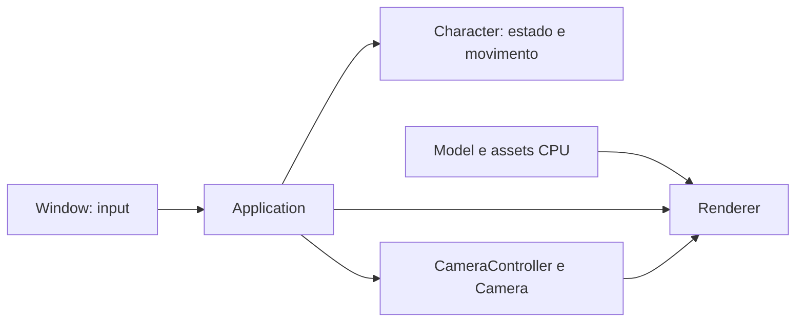

# Organização dos módulos

A aplicação conecta as partes; cada módulo cuida de uma responsabilidade. O domínio do jogo não depende de janela, renderer ou assets visuais. GLM é uma biblioteca de matemática CPU, não uma dependência de GPU.

## Estrutura implementada

```text
src/
  apps/client/        ponto de entrada e composição do cliente
  platform/           Window, contexto e eventos GLFW
  math/               convenções e transformações sobre GLM
  assets/             Model, AssetSystem, loaders e geometria estática
  scene/              Camera, CameraController e Material
  renderer/           Renderer, Shader e Mesh (recursos GPU)
    opengl/           implementação do shader e buffers OpenGL
  editor/             WorldEditor, câmera fly, seleção/transform, AssetDatabase e painéis ImGui
  animation/          skeleton, clips, poses e crossfade (main)
  character/          corpo/modelo, aparência e atributos (main)
  equipment/          slots e attachments CPU (main)
  game/
    combat/              entidades, alvos, dano, auto-ataque e habilidades CPU
    world/            limites de movimento do protótipo
    items/            definições de armas e itens de combate
    client/           câmera de combate e preparação de animações do personagem
content/              convenções para arquivos de conteúdo futuros
tests/                verificações CPU sem janela
```

`src/assets/` contém o código que representa recursos, enquanto os arquivos artísticos podem estar em `assets/`, `content/` ou nos diretórios de origem já existentes. O loader GLB/glTF fornece dados CPU; o Asset Browser indexa esses modelos e os prefabs de `content/prefabs/`. O renderer de instâncias do editor suporta geometria estática e ainda não envia texturas para a GPU.

O cliente inclui ImGui com os backends GLFW/OpenGL3 para os painéis de edição. `SelectionManager` mantém a hierarquia e os transforms dos objetos; a interface é somente uma visualização/controlador desses dados CPU.

## Fluxo de um frame




## Ownership e contratos

- `Character` encapsula posição e orientação. Input é uma intenção (`MovementInput`), sem códigos de tecla ou chamadas GLFW. O limite de tempo de frame continua na aplicação; tick fixo e autoridade de servidor ficam para o Marco 005.
- `Renderer` recebe modelos carregados por `assets::Model`; não mantém um catálogo paralelo de meshes procedurais.
- `Mesh` e `Shader` possuem os recursos GPU e os liberam por RAII. Não podem ser copiados. O renderer deve ser destruído antes da janela/contexto; a ordem de variáveis na aplicação garante isso.
- `Material` é um valor com cor e padrão de superfície.
- `Camera` calcula visão e projeção; `CameraController` converte mouse/scroll em órbita. O controlador retorna o delta de rotação, e a aplicação decide se também deve girar o personagem. A câmera de combate e a preparação das animações do personagem ficam em `game/client`.

As convenções matemáticas são: mundo destro, Y para cima, frente do personagem em +Z, ângulos em radianos, matrizes column-major e composição `parent * local`. A projeção usa profundidade OpenGL de -1 a +1.

## Onde implementar a próxima funcionalidade

| Funcionalidade | Lugar |
| --- | --- |
| Importar modelo / textura para memória CPU | `assets/` |
| Arquivos originais de arte | `content/source/` quando existirem |
| Criar buffers / texturas GPU | `renderer/opengl/` |
| Atributos e regras de personagem | `game/characters/` |
| Definições de item, inventário e equipamento | `game/items/` |
| Aparência de equipamento ou personagem | `game/client/` |
| Limites, colisão e regras do mundo | `game/world/` |
| Modos e ferramentas de edição do cliente | `editor/`, coordenados por `apps/client/` |
| Sessões e sincronização | novos módulos `network/` e `game/server/` no Marco 005 |

## Orientação a objetos aplicada

A mudança corrige principalmente responsabilidade única e acoplamento: renderer não monta personagem, aplicação não implementa movimento, e itens não dependem da representação visual. O carregador de funções OpenGL é fornecido pela aplicação, removendo a dependência direta do renderer em Window.

Encapsulamento protege o estado de `Character`. `Material` continua sendo um valor simples. Composição é suficiente para o estado atual; não há classe-base Entity, singleton global ou fábrica abstrata sem uso concreto. Liskov e segregação de interfaces não eram problemas demonstrados pelo código anterior, que não possuía essas hierarquias.

## Limites no build e validação

Os targets `mmo_game`, `mmo_assets`, `mmo_scene`, `mmo_presentation`, `mmo_platform` e `mmo_renderer` declaram suas dependências no CMake. `mmo_game` depende apenas de matemática e opções de compilação; `mmo_renderer` não depende de `mmo_game` ou `mmo_platform`.

`MMO_BUILD_CLIENT=OFF` remove GLFW, GLAD e o renderer do build. O CTest verifica velocidade diagonal, orientação, limites do mundo, composição/animação, combate e câmera. As bibliotecas CPU continuam disponíveis para um futuro servidor, mas não implementam ainda uma simulação autoritativa nem determinismo de rede.

## Integração da main

Os módulos `animation`, `character`, `equipment` e `assets/model` e a suíte CharacterEquipmentTest compõem o caminho atual do personagem. O estado de locomoção e a apresentação usam `character::Character`; o protótipo duplicado de `game::characters::Character` foi removido.

Os atalhos de armas e classes, a normal matrix calculada na CPU e o skinning de quatro influências foram integrados às APIs modulares. Não é necessário linkar o renderer para executar testes de skeleton, modelos ou equipamento. Os presets Windows 2022/2026 do time são mantidos; configurações Linux pessoais continuam locais.
