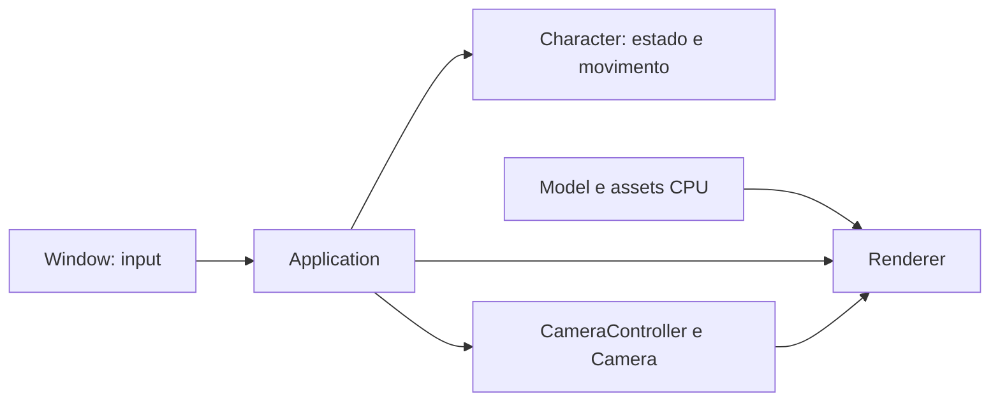

# Organização dos módulos

## Camadas

O código está dividido em camadas. Uma camada só depende das que estão abaixo dela,
e o `LayeringTest` (CTest, `cmake/check_layering.cmake`) falha se um include violar
essa regra.

```text
apps/client          composição: cria sistemas, roteia input, desenha UI
  │
presentation/        ponte jogo → engine no cliente (itens → equipamento visual)
  │            \
game/                regras: combate, itens, inventário, loadout
  │                  só core/, world/ e GLM: é o que o servidor vai linkar
  │
engine               core, world, animation, assets, equipment, character,
                     scene, editor, renderer, platform
                     nunca inclui game/, presentation/ ou apps/
```

| Módulo | Target | Responsabilidade |
| --- | --- | --- |
| `core/` | `mmo_core` | Formato texto versionado chave=valor usado pelo conteúdo |
| `world/` | `mmo_world` | Terreno (heightfield em chunks, páginas de região em disco) e colisão AABB |
| `animation/` | `mmo_animation` | Skeleton, pose, clips, camadas locomoção/ação, eventos |
| `assets/` | `mmo_assets` | Importação glTF/GLB (fastgltf), modelos CPU, geometria estática |
| `equipment/` | `mmo_equipment` | Contrato `Equipment`, `Weapon`, `BasicEquipment`, slots visuais e encaixes em bones |
| `character/` | `mmo_character` | Corpo/modelo, controlador de movimento, `CombatController` (clip de ataque) |
| `scene/` | `mmo_scene` | Câmera e controlador de órbita |
| `editor/` | `mmo_editor` | Modos, câmera livre, seleção, transformação, asset database, histórico (undo/redo) e documento de mundo `.mmoworld` (UI ImGui fica no cliente) |
| `game/combat/` | `mmo_game` | Entidades de combate, alvos, auto-ataque, dano, `WeaponStats`, habilidades/recursos por classe (`AbilitySystem`) |
| `game/items/` | `mmo_game` | `ItemDefinition`, `ItemCatalog`, `Inventory`, `Loadout` — ver [itens](items.md); `weapons.hpp`: catálogo fixo dos tipos de arma 4–8 (classe, habilidades, variações de ataque) |
| `presentation/` | `mmo_presentation` + cliente | `ItemVisual`, `LoadoutPresenter`; `EquipmentPresenter` (usa renderer) |
| `renderer/`, `platform/` | `mmo_client` | OpenGL e GLFW |
| `apps/client/` | `mmo_client` | `application.cpp`, `PlayerItems`, `DemoEnemies`, setup de animação, janelas ImGui |

## Fluxos que cruzam módulos

**Combate.** `game::combat::CombatSystem` decide se e quando golpear (alvo, alcance,
linha de visão, cooldown) e usa os `WeaponStats` da arma equipada ou os valores
desarmados. Para golpear, chama `character::CombatController::request_primary_attack`,
que toca o clip da arma (ou `Punch_Jab`). O evento `AttackHit` da animação volta para
`CombatSystem::on_attack_hit`, que revalida e aplica o dano.


**Itens.** Ver [itens](items.md). Em resumo: `Inventory`/`Loadout` (regra) →
`LoadoutPresenter` (constrói `Weapon`/`BasicEquipment`) → `EquipmentManager` →
`EquipmentPresenter` → `Renderer`.

**Desenho.** O renderer não sabe o que é jogador ou inimigo: recebe uma lista de
`SkinnedInstance` (posição, tint, paleta de skinning, attachments rígidos). A matriz
de um attachment é `instance_world * joint_global * attachment_local`.

## Pontos para a próxima organização

- `application.cpp` ainda concentra o input do editor, do terreno e o laço principal;
  candidatos naturais são uma sessão de editor e um roteador de input.
- `character::CombatState`/`CombatSystem` (contador de eventos) e
  `game::combat::CombatState`/`CombatSystem` (regra) têm nomes iguais em camadas
  diferentes.
- `EquipmentSlot` (engine) e `ItemSlot` (jogo) são enums paralelos; `static_assert`s em
  `presentation/item_visuals.cpp` garantem que continuem alinhados.
